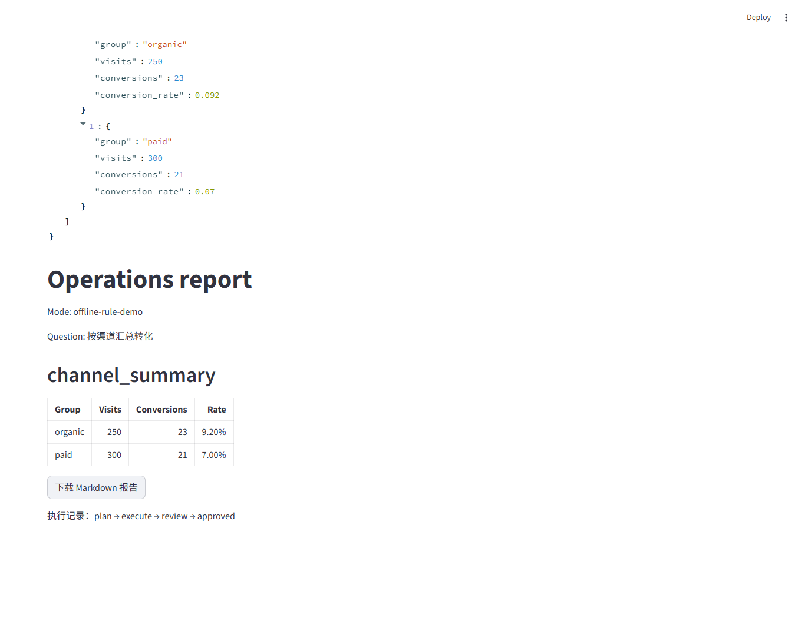

# 运营报告 Agent 审核工作流

基于 Local Deep Researcher 的StateGraph模式进行业务适配，保留上游研究助手源码与Git历史。新增report_agent工作流通过AI辅助实现，不声称改写了LangGraph框架。

上游：[github.com/langchain-ai/local-deep-researcher](https://github.com/langchain-ai/local-deep-researcher)。代码许可证：MIT。来源与边界见 [UPSTREAM.md](UPSTREAM.md)。



## 新增与改造

1. 适配上游graph.py/state.py中的StateGraph与状态传递模式，新增plan→execute→review→finish业务图。
2. 使用LangGraph interrupt及SqliteSaver实现人工审核、线程隔离、重启恢复；审核拒绝时不生成报告。
3. 规划器仅能选择daily_summary/channel_summary两个白名单工具，每次计划最多两项；指标由Python计算。
4. 可选兼容模型HTTP规划接口，失败有限重试；默认明确标注离线规则路由。增加Streamlit界面与Markdown下载。

## 运行

Python 3.12。先创建并激活独立虚拟环境：

```sh
python -m venv .venv
# Windows: .venv\Scripts\activate
# macOS / Linux: source .venv/bin/activate
python -m pip install -r requirements-portfolio.txt
python -m report_agent start --thread demo-1
python -m report_agent review --thread demo-1 --approve yes
python -m report_agent show --thread demo-1
# 本地界面
python -m streamlit run portfolio_app.py --server.headless true --server.address 127.0.0.1
```

## 验证

```sh
python -m pytest portfolio_tests -q --junitxml=.data/test-results.xml
```

新增套件本地验证：15项通过（2026-11-17，Windows / Python 3.12）。完整说明见 [docs/VALIDATION.md](docs/VALIDATION.md)。上游保留的测试、工作流和依赖不等同于本项目新增验证范围。GitHub Actions尚未启用。

## 统计与使用边界

- 这是固定拓扑的单工作流，不是分布式多Agent系统，也不包含模型训练或RAG。
- 未配置真实模型密钥。在线协议以mock HTTP响应测试，不能证明真实供应商兼容性。
- CSV为人工构造数据；CSV行和状态保存在本机SQLite，不能上传到公共仓库。
- 在线配置读取LLM_BASE_URL/LLM_MODEL/LLM_API_KEY，只向模型发送分析问题；不在检查点中保存密钥。
- 上游原始研究助手有独立依赖；运行新增项目只需requirements-portfolio.txt。

公开仓库只包含技术材料、代码及公开或人工构造的数据。本地运行输出与个人文档默认忽略。
